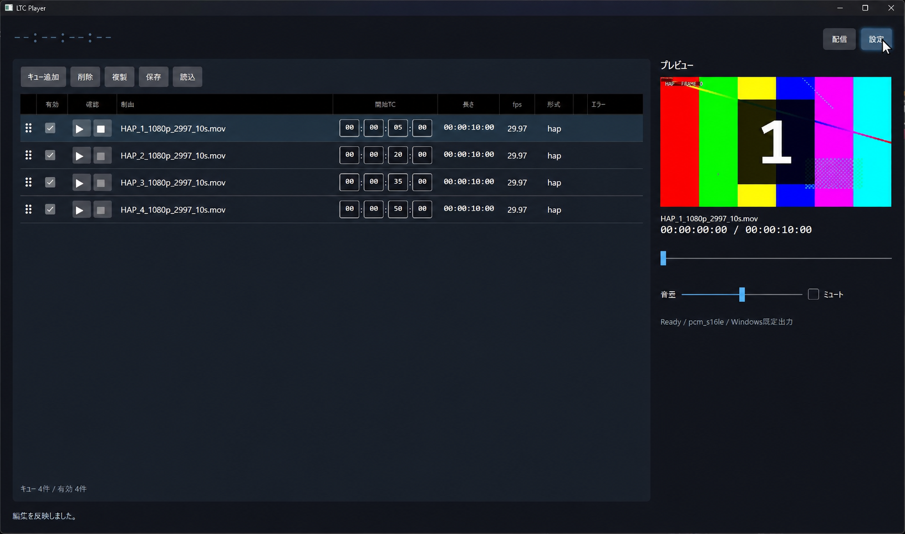
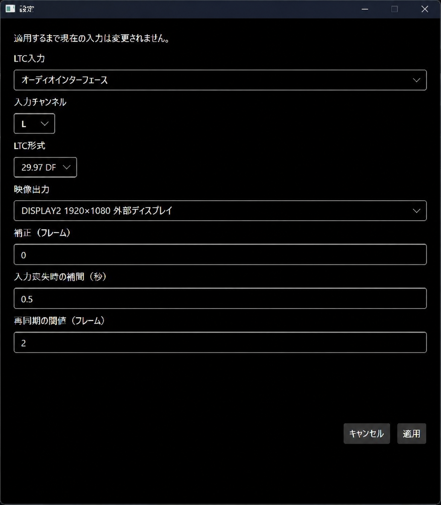

# クイックスタート

## 1. 必要なソフトを入れる

- [Visual C++ x64ランタイム](https://learn.microsoft.com/cpp/windows/latest-supported-vc-redist)：x64版をインストールします。
- [FFmpeg・ffprobe](https://ffmpeg.org/download.html)：Windows用ビルドを展開し、`ffmpeg.exe`と`ffprobe.exe`が入ったフォルダーを、ユーザー環境変数の`Path`に追加します。

<details>
<summary>Pathへの追加方法</summary>

1. `ffmpeg.exe`と`ffprobe.exe`が入っているフォルダーのパスをコピーします。
2. Windowsの検索で「環境変数」と入力し、「環境変数を編集」を開きます。
3. ユーザー環境変数の「Path」を選び、「編集」を押します。
4. 「新規」を押してコピーしたパスを貼り付け、「OK」で閉じます。

新しく開いたターミナルで次のコマンドを実行し、両方のバージョン情報が表示されれば完了です。

```powershell
ffmpeg -version
ffprobe -version
```

</details>

## 2. ダウンロードして起動する

[ダウンロードページ](https://github.com/Nirfuture/LTC_Player/releases)の「Assets」から`LtcPlayer-…-win-x64.zip`をダウンロードして展開します。

**展開したフォルダー内の`LtcPlayer.Avalonia.exe`を起動します。** ファイルは同じフォルダーにまとめたまま使用してください。

## 3. 入出力を設定する

LTCとディスプレイをPCに接続し、右上の「設定」を開きます。



- 「LTC入力」「入力チャンネル」で接続先を選ぶ
- 「LTC形式」を送信元に合わせる
- 「映像出力」で出力先のディスプレイを選ぶ

「適用」を押します。ほかの項目は、まず初期値のまま使用してください。



## 4. テスト動画を出力する

左上に受信したタイムコードが表示されたら、「出力開始」を押します。

テスト動画は登録済みです。送信元のLTCを`00:00:05:00`付近から進めると、最初の動画を確認できます。動画がない区間は黒画面になります。動画の音声は本番出力されません。

停止するときは「出力停止」を押し、確認画面で停止します。動画の登録や設定の変更は、出力を停止してから行います。

<details>
<summary>PC内でLTCを再生して試す</summary>

アプリと同じフォルダーの`TestMedia/LTC_29.97DF_from-zero.wav`を、音声プレイヤーで再生します。`00:00:00:00`から約65秒間の信号です。「LTC形式」は`29.97 DF`に合わせます。

再生音をオーディオインターフェースのループバック機能や仮想オーディオケーブルで入力へ戻し、その機器を「LTC入力」に選んでください。

</details>

## 5. 自分の動画を登録する

1. 不要なテスト動画の行を選び、「削除」を押します。
2. 動画を一覧へドラッグ＆ドロップするか、「キュー追加」から選びます。
3. 「開始TC」に再生を開始するタイムコードを入力します。
4. 「有効」にチェックが入っていることを確認し、「出力開始」を押します。

MP4/H.264、MOV/HAP・HAP Qに対応しています。追加直後の開始TCは`00:00:00:00`です。

出力前に確認するには、各行の「確認」欄の▶を押します。Ⅱで一時停止、■で停止、シークバーで再生位置を変更できます。「音量」「ミュート」はプレビュー用で、音声はWindowsの既定の出力先から流れます。プレビューは出力を停止している間に使用できます。

## 6. 保存する

「保存」を押すと、動画の登録内容と開始TCをJSONファイルに保存できます。次回は「読込」で開きます。

**自動保存はありません。終了前に保存してください。通常の起動時はテスト動画4本に戻ります。** 動画ファイルは保存データに含まれないため、使用する動画も残しておいてください。

<details>
<summary>再生順・複製について</summary>

- 再生順は開始TCで決まります。一覧を並び替えても変わりません。
- 再生時間が重なる場合は、後から始まる動画に切り替わります。その動画が終わると黒画面になり、前の動画には戻りません。
- 同じ開始TCの動画は、同時に有効にできません。
- 「複製」で追加した行は最初は無効です。開始TCを変更してから有効にしてください。

</details>

<details>
<summary>同梱テスト動画の開始TC</summary>

| 動画 | 開始TC |
|---|---|
| 1 | `00:00:05:00` |
| 2 | `00:00:20:00` |
| 3 | `00:00:35:00` |
| 4 | `00:00:50:00` |

動画に含まれる音は確認用トーンです。LTCは外部機器から入力してください。

</details>

[困ったとき](TROUBLESHOOTING.md)
