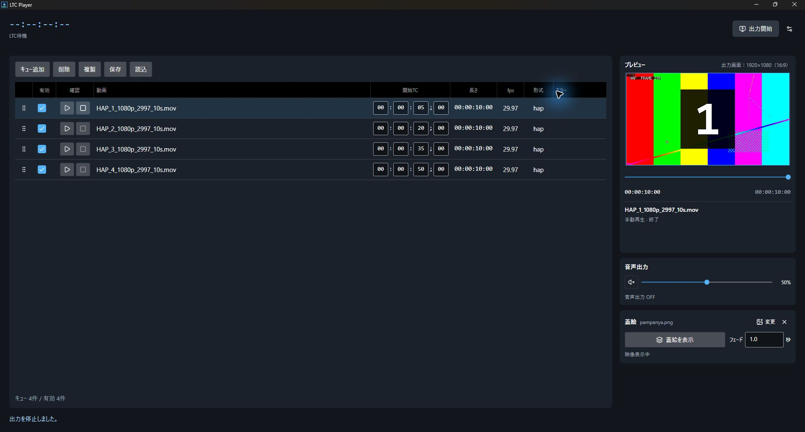
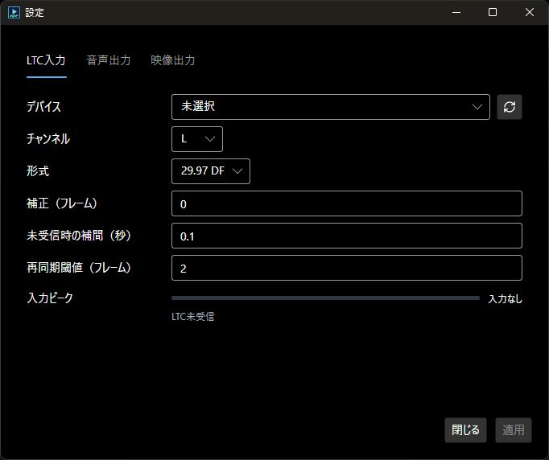
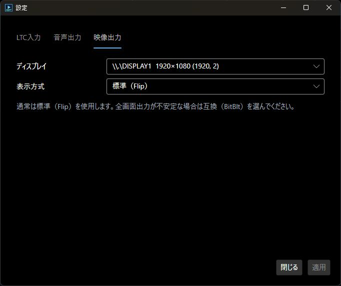

# クイックスタート

**まずは同梱の動画を再生してみましょう。LTC機器がなくても試せます。**

## 1. 準備して起動する

初めて使うPCには、次の2つを用意します。

- [Visual C++ランタイム（x64）](https://aka.ms/vc14/vc_redist.x64.exe)をインストールします（[Microsoftの案内](https://learn.microsoft.com/cpp/windows/latest-supported-vc-redist)）。
- [FFmpeg・ffprobe](https://ffmpeg.org/download.html)のWindows用ビルドを展開し、2つのEXEが入った`bin`フォルダーをPathに追加します。

<details>
<summary>FFmpegのPathへの追加方法</summary>

1. `ffmpeg.exe`と`ffprobe.exe`が入っているフォルダーを開き、アドレスバーのパスをコピーします。
2. Windowsの検索で「環境変数」と入力し、「環境変数を編集」を開きます。
3. **ユーザー環境変数**の「Path」→「編集」→「新規」で、コピーしたパスを貼り付けます。
4. 「OK」で閉じます。LTC Playerを起動済みなら、一度終了して起動し直してください。

新しく開いたターミナルで、次の両方のバージョン情報が表示されれば準備完了です。

```powershell
ffmpeg -version
ffprobe -version
```

</details>

[ダウンロードページ](https://github.com/Nirfuture/LTC_Player/releases)の「Assets」から`LtcPlayer-…-win-x64.zip`を取得して、**すべて展開**します。

展開したフォルダーの **`LtcPlayer.Avalonia.exe`** を起動してください。**.NETの追加インストールは不要です。**

## 2. まず動画を再生する

テスト動画は4本登録済みです。**LTCを送っていない状態で、最初の行の「確認」▶を押します。** 右側に映像が出れば、最初の再生は成功です。



- Ⅱで一時停止、■で停止。プレビュー直下のバーで再生位置を変えられます。
- **音を出すには、右側「音声出力」のスピーカーボタンをONにします。** 起動時はOFFです。

## 3. LTCに同期して、外部画面へ出す

LTC機器と外部ディスプレイをPCに接続し、右上の**調整つまみのアイコン（設定）**を開きます。

| タブ | 最初に設定するもの |
|---|---|
| LTC入力 | 接続したデバイス、L/Rチャンネル、送信元と同じ形式 |
| 映像出力 | 映像を出すディスプレイ |
| 音声出力 | 音も出す場合に、音声の出力先 |

ほかは、まず初期値のままで構いません。**「適用」→「閉じる」**を押します。

<details>
<summary>設定画面を見る</summary>

**LTC入力：デバイス・チャンネル・形式を選びます。** 下の入力ピークで、信号が入っているか確認できます。機器名はPCによって異なります。



**映像出力：ディスプレイを選びます。** 表示方式は通常「標準（Flip）」のまま使用します。



</details>

同梱動画で試すなら、LTC形式を**29.97 DF**に合わせ、送信元を **`00:00:05;00`付近**から進めます。「LTC受信中」が緑になり、プレビューが動くことを確認してください。

**右上の「出力開始」を押すと、外部画面にも同じ映像が出ます。** 動画のない区間は黒になります。

停止は「出力停止」から行います。**映像出力を止めても音声は続くため、音も止める場合はスピーカーボタンをOFFにしてください。**

## 4. 自分の動画に入れ替えて、保存する

1. 不要なテスト動画の行を選び、「削除」します。
2. 動画を一覧へドラッグ＆ドロップするか、「キュー追加」で選びます。
3. 「開始TC」を入力し、「有効」にチェックを入れます。
4. **「保存」でJSONファイルに保存します。** 次回は「読込」で開きます。

MP4/H.264、MOV/HAP・HAP Qに対応しています。編集するときは外部映像出力を停止してください。

**自動保存はありません。終了前に保存してください。** 通常起動時はテスト動画4本に戻ります。動画そのものはJSONに含まれないため、素材も残してください。

<details>
<summary>蓋絵を使う</summary>

右側の「蓋絵」エリアでPNG/JPEGを登録します。「蓋絵を表示」で切り替え、「映像に戻す」で解除します。切替時間0秒なら即時です。

蓋絵の間も動画と音声は進みます。画像の登録・変更は外部映像出力を停止してから行ってください。

</details>

ここまでできれば基本操作は完了です。

[詳しい使い方](USER_GUIDE.md) · [困ったとき](TROUBLESHOOTING.md) · [対応環境・動画形式](COMPATIBILITY.md)
