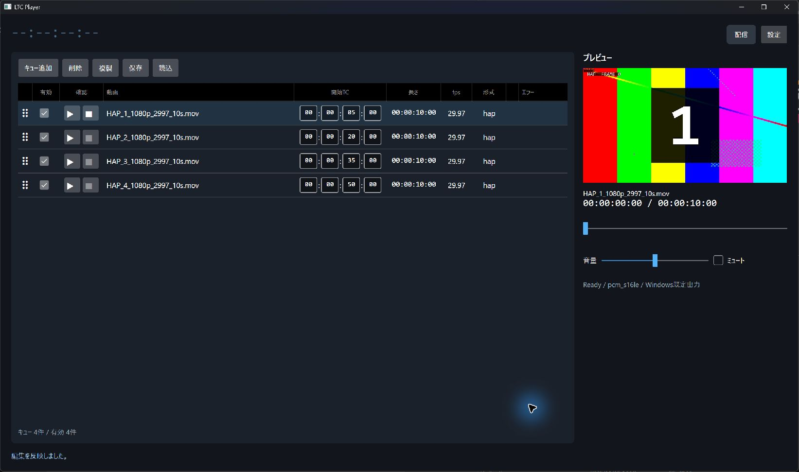
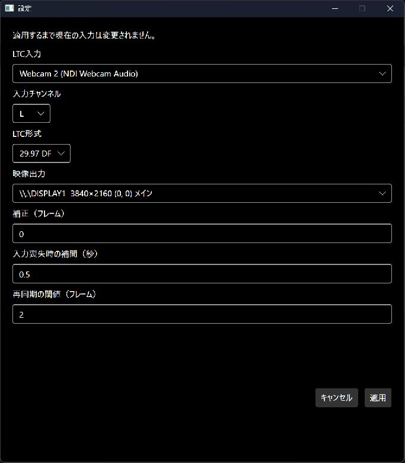

# クイックスタート

初めて使う場合は、[初回セットアップ](SETUP.md)から進めてください。

## 1. 「設定」を開く

LTCとディスプレイをPCに接続し、アプリの「設定」を開きます。

## 2. 入出力を選ぶ

- 「LTC入力」「入力チャンネル」で接続先を選ぶ
- 「LTC形式」を送信元に合わせる
- 「映像出力」で出力先のディスプレイを選ぶ

「適用」を押します。ほかの項目は、まず初期値のまま使用してください。

## 3. 「配信」を押す

左上に受信したタイムコードが表示されたら、「配信」を押します。

テスト動画は登録済みです。送信元のLTCを `00:00:05:00` 付近から進めると、最初の動画を確認できます。動画がない区間は黒画面になります。

停止するときは「配信停止」を押し、確認画面で停止します。

## 自分の動画を使う

出力を停止し、動画を一覧へドロップして「開始TC」を入力します。

終了前に「保存」を押してください。自動保存はありません。

[動画の登録と操作](OPERATIONS.md) · [困ったとき](TROUBLESHOOTING.md)
